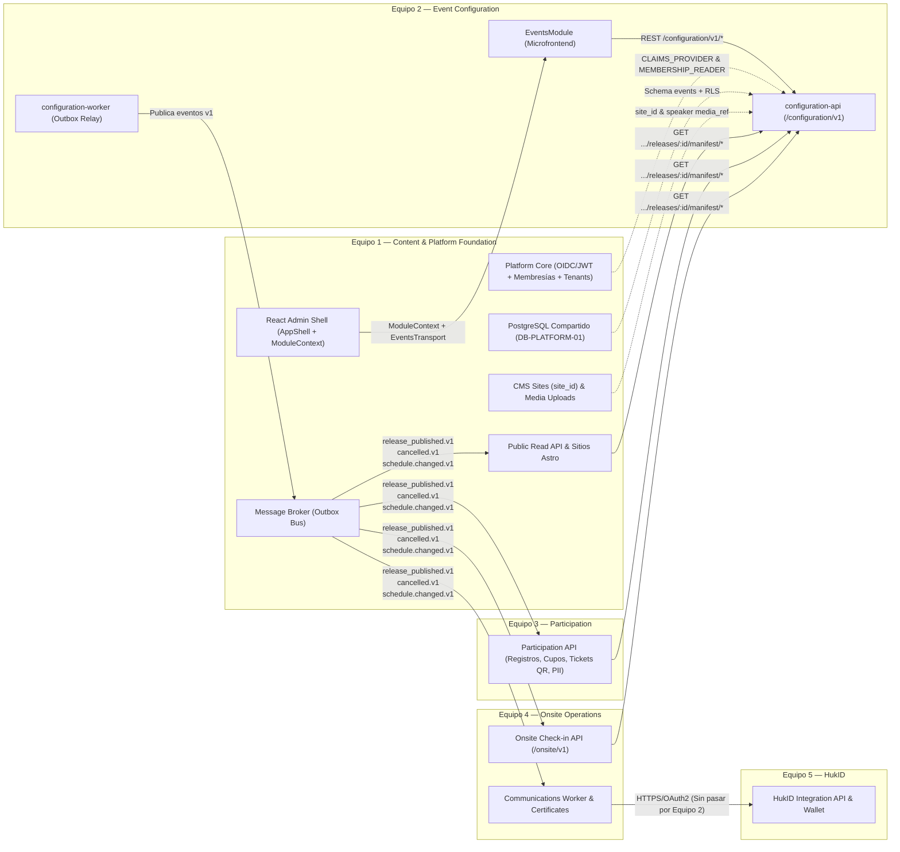

# Guía de Integración Externa y Acoplamiento por Equipos — Event Configuration (Equipo 2)

Este documento consolida **todos los puntos de acoplamiento externo** del microservicio `event-configuration` (`apps/configuration-api`, `apps/configuration-worker`) y del microfrontend `frontend/src/microfrontends/events`, identificando con exactitud **a qué equipo de la plataforma pertenece cada integración** según la arquitectura normativa (`event-platform-architecture-main`, `Acople_externo.md` y `MATRIZ-CONTRATOS-NEXO.md`).

---

## 1. Mapa Oficial de Equipos y Fronteras de Dominio

| Equipo | Nombre Oficial en Arquitectura | Rol frente al Equipo 2 (`Event Configuration`) |
| :--- | :--- | :--- |
| **Equipo 1** | **Content & Platform Foundation** | **Proveedor de Plataforma** (Core API de Identidad/JWT, Membresías, Directorio de Tenants, PostgreSQL compartido `DB-PLATFORM-01`, Broker de eventos, React Admin Shell `AppShell`, Sitios `site_id` y Servicio de Medios) y **Consumidor de Dominio** (CMS y Public Read API `/public/v1/*` que proyectan el catálogo público de eventos y agendas). |
| **Equipo 2** | **Event Configuration** *(Este equipo)* | **Dueño y Productor** de `/configuration/v1/*`, schema PostgreSQL `events`, `configuration-worker` (Outbox Relay), manifiestos/artefactos inmutables de publicación (`event`, `schedule`, `forms`) y microfrontend administrativo `events`. |
| **Equipo 3** | **Participation** | **Consumidor de Dominio** de releases publicados (`forms`, `event` / `registration_policy`) y eventos de cancelación/cierre. Es el **único dueño** de inscripciones, control transaccional de cupos/waitlist, emisión/revocación de tickets QR JWS, postulaciones y respuestas con PII cifrada. |
| **Equipo 4** | **Onsite Operations** | **Consumidor de Dominio** de releases publicados (`schedule`, `event`) y eventos de cancelación/cambio de agenda. Opera **dos subsistemas**: **(1) Onsite Check-in** (`/onsite/v1/*`, validación QR y hechos append-only de asistencia) y **(2) Operations** (Communications Worker para correos/notificaciones, Reporting/Certificates API y adaptador outbound hacia HukID). |
| **Equipo 5** | **HukID (Issuer/Node & Wallet)** | **Sin acoplamiento directo con Equipo 2.** HukID es un sistema externo aislado que no accede a la base de datos ni al bus de eventos de Nexo; se comunica exclusivamente con el adaptador outbound HTTPS/OAuth2 del **Equipo 4 (Onsite Operations)**. |



---

## 2. Matriz Completa de Acoplamientos Externos

| # | Integración | Equipo Externo Responsable | Dirección | Punto Exacto en `event-configuration` | Estado Actual |
| :-: | :--- | :--- | :---: | :--- | :--- |
| **1** | **Identidad, Sesión y Autorización (`CLAIMS_PROVIDER`)** | **Equipo 1** — Content & Platform Foundation | Equipo 1 → Equipo 2 | `apps/configuration-api/src/shared/auth/auth.guard.ts` y `claims-selection.ts` | **Puerto preparado; simulado en dev (`AUTH_MODE=mock`).** |
| **2** | **Validación de Membresías Activas (`MEMBERSHIP_READER`)** | **Equipo 1** — Content & Platform Foundation | Equipo 1 → Equipo 2 | `apps/configuration-api/src/events/domain/ports/membership-reader.port.ts` y `membership-selection.ts` | **Puerto preparado; simulado en dev (`MEMBERSHIP_MODE=mock`).** |
| **3** | **PostgreSQL Compartido (`DB-PLATFORM-01`) y Discovery de Tenants** | **Equipo 1** — Content & Platform Foundation | Equipo 1 → Equipo 2 | `apps/configuration-api/src/shared/database/database.service.ts`, `db/nexo-migrations/` y `WORKER_TENANT_IDS` en `worker-config.mjs` | **Preparado en schema `events` con RLS; falta provisión común y discovery de tenants.** |
| **4** | **Eventos de Ciclo de Vida de Organización y Membresía** | **Equipo 1** — Content & Platform Foundation | Equipo 1 → Equipo 2 | `platform.organization.lifecycle_changed.v1` y `platform.membership.changed.v1` | **Definido en catálogo de arquitectura; consumidor pendiente.** |
| **5** | **Shell React (`ModuleContext`) y Cliente HTTP (`EventsTransport`)** | **Equipo 1** — Content & Platform Foundation | Equipo 1 → Equipo 2 | `frontend/src/microfrontends/events/EventsModule.tsx`, `api.ts` y `capabilities.ts` | **Preparado e integrado en `frontend/`; falta inyección de transporte autenticado del Shell.** |
| **6** | **Sitios (`site_id`), Medios de Ponentes y Consentimiento** | **Equipo 1** — Content & Platform Foundation *(+ Privacy Owner)* | Equipo 1 ↔ Equipo 2 | `site_id` en `events`, `media` y `GET /configuration/v1/speakers/consent-notice` (`SPEAKER_CONSENT_NOTICE_*`) | **Endpoint y validación listos; falta acuerdo de referencias con CMS/Medios.** |
| **7** | **Broker de Mensajería y Entrega desde Outbox (`OutboxRelay`)** | **Equipo 1** — Plataforma del Broker *(Consumidores: Equipos 1, 3 y 4)* | Equipo 2 → Broker | `apps/configuration-worker/src/main.mjs`, `outbox-relay.mjs` y `simulated-broker.mjs` | **Relay transaccional con leases listo; broker simulado (`BROKER_MODE=simulator`).** |
| **8** | **Consumo de Releases para Catálogo y Páginas Públicas** | **Equipo 1** — Content & Platform Foundation (CMS / Public Read API) | Equipo 2 → Equipo 1 | Evento `configuration.event.release_published.v1` + `GET .../manifest/artifacts/event` y `schedule` | **Manifiesto, hashes RFC 8785 y endpoints listos.** |
| **9** | **Consumo de Releases de Formularios y Políticas de Registro** | **Equipo 3** — Participation | Equipo 2 → Equipo 3 | Evento `configuration.event.release_published.v1` + `GET .../manifest/artifacts/forms` y `event` + `configuration.event.cancelled.v1` | **Endpoints de forms/bindings y artefactos listos (provider en transición de fixture a DB).** |
| **10** | **Consumo de Releases de Agenda/Sedes para Check-in y Comunicaciones** | **Equipo 4** — Onsite Operations (Onsite + Operations/Comms) | Equipo 2 → Equipo 4 | Eventos `release_published.v1`, `cancelled.v1`, `schedule.changed.v1` + `GET .../manifest/artifacts/schedule` y `event` | **Artefacto `schedule` desde PostgreSQL y `cancelled.v1` listos; `schedule.changed.v1` pendiente de schema.** |
| **11** | **Emisión de Credenciales Verificables en Wallet** | **Equipo 5** — HukID | Sin conexión con Equipo 2 | Se conecta exclusivamente con el adaptador outbound del **Equipo 4** (`POST /v1/issuance-requests`). | **Frontera aislada por diseño.** |

---

## 3. Integraciones con el Equipo 1 — Content & Platform Foundation

El **Equipo 1** concentra tanto la base de plataforma (**Platform Foundation / Core**) como la experiencia pública y editorial (**CMS, Sitios Astro y Medios**).

### 3.1 Identidad y Sesión Verificada (`CLAIMS_PROVIDER`)
- **Archivos en Equipo 2:**
  - Contrato e interceptor: `apps/configuration-api/src/shared/auth/auth.guard.ts`
  - Selector de proveedor: `apps/configuration-api/src/shared/auth/claims-selection.ts`
  - Validación de formato: `apps/configuration-api/src/shared/auth/validate-tenant-claims.ts`
- **Contrato a implementar:**
  ```ts
  export interface ClaimsProvider {
    resolve(request: ClaimsRequest): TenantClaims | Promise<TenantClaims>;
  }

  export interface TenantClaims {
    sub: string;              // UUID del usuario o service account autenticado
    organization_id: string;  // UUID del tenant activo (aplicado en PostgreSQL RLS)
    roles: string[];          // Ej.: ['org_owner', 'event_manager', 'report_viewer']
    scopes: string[];         // 'events:read' | 'events:write' | 'events:publish'
    request_id?: string;
    client_ip?: string;
    user_agent?: string;
  }
  ```
- **Reglas de acoplamiento:**
  - `selectClaimsProvider` bloquea `AUTH_MODE=mock` fuera de `development`/`test`.
  - El adaptador productivo debe verificar el token o sesión emitida por el Core/OIDC del **Equipo 1** (incluyendo vigencia, audience `event-configuration-api` y estado activo de sesión), sin confiar en headers libres del navegador (`x-dev-actor` es exclusivo de desarrollo/test).

### 3.2 Validación de Membresías Activas (`MEMBERSHIP_READER`)
- **Archivos en Equipo 2:**
  - Puerto: `apps/configuration-api/src/events/domain/ports/membership-reader.port.ts`
  - Selector: `apps/configuration-api/src/events/infrastructure/adapters/membership-selection.ts`
  - Mock de desarrollo: `apps/configuration-api/src/events/infrastructure/adapters/membership.adapter.ts`
- **Dónde se invoca:** En `EventsService.createAssignment` (`POST /configuration/v1/events/:id/assignments`, historia `EC-006`) antes de otorgar un rol sobre un evento/sede.
- **Contrato a implementar:**
  ```ts
  export const MEMBERSHIP_READER = Symbol('MEMBERSHIP_READER');

  export interface MembershipReader {
    validateActiveMembership(
      organizationId: string,
      userId: string,
    ): Promise<{ isValid: boolean; reason?: string }>;
  }
  ```
- **Reglas de acoplamiento:**
  - Si `MEMBERSHIP_MODE` no está configurado con un proveedor real en producción, `UnavailableMembershipReader` responde `503 Service Unavailable` (fail-closed).
  - Adicionalmente, según `EVENT-CONTRACTS.md`, el **Equipo 1** emite `platform.membership.changed.v1` y `platform.organization.lifecycle_changed.v1` para que los servicios invaliden membresías revocadas o bloqueen tenants suspendidos.

### 3.3 PostgreSQL Compartido (`DB-PLATFORM-01`) y Discovery de Tenants para el Worker
- **Archivos en Equipo 2:**
  - Conexión y verificación RLS: `apps/configuration-api/src/shared/database/database.service.ts`
  - Migraciones listas para Nexo: `db/nexo-migrations/0001..0008_*.sql` y `scripts/migrate.mjs`
  - Configuración del Worker: `apps/configuration-worker/src/infrastructure/config/worker-config.mjs`
- **Puntos que el Equipo 1 debe provisionar / acordar:**
  1. Crear el schema `events` y las tablas de control en `platform_meta` (`platform_meta.events_schema_migrations` y `platform_meta.events_migration_checksums`), otorgando rol de migrador (`events_migrator`) y rol de ejecución restringido (`configuration_app` con `NOSUPERUSER NOBYPASSRLS`). **Importante:** nunca ejecutar `scripts/bootstrap-local.mjs` contra la base compartida `nexo`.
  2. Reemplazar la variable manual `WORKER_TENANT_IDS` del worker por el mecanismo autorizado de discovery de tenants activos del **Equipo 1**.

### 3.4 Integración del Microfrontend en el Shell React (`AppShell`)
- **Archivos en Equipo 2:**
  - Componente raíz: `frontend/src/microfrontends/events/EventsModule.tsx`
  - Transporte HTTP: `frontend/src/microfrontends/events/api.ts`
  - Capacidades: `frontend/src/microfrontends/events/capabilities.ts` (`events:read`, `events:write`, `events:publish`)
  - Registro de rutas: `frontend/src/platform/microfrontends/registry.tsx`
- **Punto de enganche para el Equipo 1:**
  ```tsx
  export function EventsModule({
    context,
    transport,
  }: {
    context: ModuleContext;
    transport?: EventsTransport;
  })
  ```
  - Cuando el **Equipo 1** publique el cliente HTTP autenticado del Shell (con inyección de `Authorization: Bearer <access_token>` y renovación de sesión), debe pasarlo en la prop `transport` desde `ModuleLoader` en `frontend/src/shell/AppShell.tsx` y devolver el ítem `events` con sus capabilities reales en `/v1/navigation/sidebar`.

### 3.5 Sitios (`site_id`), Medios de Ponentes y Consumo desde CMS / Public Read API
1. **Sitios (`site_id`) y Medios:**
   - Al crear un evento (`POST /configuration/v1/events`), `site_id` corresponde a un sitio gestionado por el CMS del **Equipo 1** (`POST /cms/v1/sites`).
   - Las referencias de fotografía/media de ponentes provienen del servicio de carga de medios del **Equipo 1** (`POST /cms/v1/media-uploads`).
   - El endpoint `GET /configuration/v1/speakers/consent-notice` sirve el aviso de privacidad configurado en `SPEAKER_CONSENT_NOTICE_TEXT` y `SPEAKER_CONSENT_NOTICE_VERSION`.
2. **Consumo de Releases por el Public Read API del Equipo 1 (`CE-04`, `CE-06`):**
   - El servicio de lectura pública del **Equipo 1** escucha `configuration.event.release_published.v1` y `configuration.event.cancelled.v1`, descarga los artefactos `event` y `schedule` (`GET /configuration/v1/events/:id/releases/:release_id/manifest/artifacts/event` y `.../schedule`), y materializa la proyección pública cacheable servida en `GET /public/v1/sites/{slug}/events` y `GET /public/v1/sites/{slug}/events/{event_slug}`.

---

## 4. Integraciones con el Equipo 3 — Participation (Inscripciones, Cupos y Tickets)

El **Equipo 3** nunca lee las tablas de `events.*` ni decide la configuración editorial; consume snapshots publicados de `event-configuration` y es el único dueño de los registros y cupos:

### 4.1 Qué debe consumir el Equipo 3 desde el Equipo 2
1. **Suscripción al evento `configuration.event.release_published.v1`:**
   - Schema: `contracts/configuration/schemas/configuration.event.release_published.v1.json`
   - Al recibirlo, descarga el manifiesto en `data.manifest_ref` (`/configuration/v1/events/:id/releases/:release_id/manifest`), verifica el `manifest_hash` SHA-256 (RFC 8785 Canonical JSON) y descarga dos artefactos:
     - **`GET .../manifest/artifacts/event`:** Contiene `status`, ventana del evento (`starts_at`, `ends_at`, `timezone`) y `policy` (`registration_policy`, apertura/cierre de inscripciones y reglas de capacidad). El **Equipo 3** materializa esta policy en su propia base transaccional (`PA-010`, `PA-011`).
     - **`GET .../manifest/artifacts/forms`:** Contiene las versiones publicadas e inmutables de los formularios (`schema` JSON Schema Draft 2020-12, `ui_schema`, `consent`, `field_policies`) y sus `bindings` activos por alcance (`EVENT`, `PROGRAM`, `SESSION`) para renderizar la isla React pública (`PA-001`) y validar envíos (`RegistrationCreate`, `ApplicationSubmit`).
2. **Consulta directa de Formularios y Bindings en `/configuration/v1`:**
   - Endpoints disponibles en `FormsController` (`apps/configuration-api/src/forms/presentation/forms.controller.ts`):
     - `GET /configuration/v1/forms` y `GET /configuration/v1/forms/:formId/versions/:versionId`
     - `GET /configuration/v1/events/:id/form-bindings`
3. **Suscripción a `configuration.event.cancelled.v1` y Cierres (`EC-004`, `EC-005`):**
   - Schema: `contracts/configuration/schemas/configuration.event.cancelled.v1.json`
   - Cuando un organizador cierra inscripciones (`POST /configuration/v1/events/:id/closures`) o cancela el evento (`POST /configuration/v1/events/:id/cancellations`), el **Equipo 3** corta inmediatamente el alta de nuevos registros y, en caso de cancelación del evento, revoca los tickets emitidos y actualiza la lista firmada de revocación (`PA-015`).

> [!WARNING]
> **Límite estricto de privacidad y propiedad de datos (Equipo 2 vs. Equipo 3):**
> `event-configuration` (Equipo 2) **solo posee la definición/estructura del formulario (`schema`, `ui_schema`, `bindings`)**. Las respuestas enviadas por los asistentes o postulantes contienen PII y se envían exclusivamente a la API del **Equipo 3 (`Participation`)**, nunca a `configuration-api`.

---

## 5. Integraciones con el Equipo 4 — Onsite Operations (Check-in, Comunicaciones y Certificados)

El **Equipo 4** interactúa con el Equipo 2 a través de dos subsistemas distintos definidos en `TEAM-4-ONSITE-OPERATIONS.md`:

### 5.1 Subsistema A: Onsite Check-in API (`/onsite/v1/*`)
1. **Precarga de Release Activa (`OO-003`, `OO-015`):**
   - Escucha `configuration.event.release_published.v1` y descarga:
     - `GET /configuration/v1/events/:id/releases/:release_id/manifest/artifacts/event`
     - `GET /configuration/v1/events/:id/releases/:release_id/manifest/artifacts/schedule`
   - Del artefacto `schedule` obtiene la lista oficial e inmutable de:
     - **Sedes y Salas (`venues`):** `id`, `kind` (`venue` | `room`), `parent_venue_id`, `name`, `capacity`, `accessibility`.
     - **Programas (`programs`):** `id`, `slug`, `name`.
     - **Sesiones (`sessions`):** `id`, `program_id`, `venue_id`, `title`, `starts_at`, `ends_at`, `speaker_ids` (para validar check-in por alcance de sesión `scope=session` y controlar aforo local de sala).
2. **Asignaciones de Personal por Evento (`EC-006`, `OO-002`):**
   - `GET /configuration/v1/events/:id/assignments` expone las asignaciones activas (`role`, `scopes`, `valid_from`, `valid_to`) otorgadas sobre un evento para operadores y supervisores.
3. **Reacción ante Cancelación (`configuration.event.cancelled.v1`):**
   - Invalida la operación de check-in para el `event_id` cancelado.

### 5.2 Subsistema B: Operations (Communications Worker, Reporting y Certificados)
1. **Communications Worker (`OO-021`, `EC-005`, `EC-034`):**
   - Consume `configuration.event.cancelled.v1` y `configuration.schedule.changed.v1` para disparar notificaciones transaccionales a los participantes afectados.
2. **Reporting y Certificados (`OO-030..040`):**
   - Utiliza los metadatos publicados del evento y sesiones del artefacto `event` / `schedule` para contextualizar reportes de asistencia y emisión de certificados PDF.

---

## 6. Frontera con el Equipo 5 — HukID (Sin Acoplamiento Directo)

De acuerdo con `INTEGRATION-CONTRACTS.md` (sección *"Dependencias autorizadas"*) y `TEAM-5-HUKID.md` (`HK-013`):
- **El Equipo 5 (HukID) NO consume eventos del bus de Nexo ni realiza llamadas a `/configuration/v1/*`.**
- Cuando un participante obtiene un certificado elegible, es el **adaptador outbound del Equipo 4 (Onsite Operations)** quien invoca por HTTPS/OAuth2 `POST /v1/issuance-requests` en la Integration API de HukID.

---

## 7. Conexión del Broker en `configuration-worker` y Consumidor de Referencia

### 7.1 Dónde conectar el Broker real (Equipo 1 — Plataforma)
En `apps/configuration-worker/src/main.mjs`, `OutboxRelay` reclama lotes de `events.outbox` con arrendamiento (`leased_by`, `lease_until`) y delega el envío al adaptador de broker:

```js
// apps/configuration-worker/src/main.mjs
// Reemplazar SimulatedBroker por el adaptador del broker real cuando BROKER_MODE !== 'simulator'
export class PlatformBrokerPublisher {
  async publish(record) {
    // record: { id, organization_id, aggregate_type, aggregate_id, event_type, payload, headers }
    // Debe retornar { accepted: true } únicamente tras confirmación durable del broker.
    return { accepted: true };
  }
}
```

### 7.2 Consumidor de Referencia para Equipos 1, 3 y 4 (`EC-032`)
En `tests/contract-consumer/release-consumer-simulator.ts` se incluye la implementación de referencia (`ReleaseConsumerSimulator`) que los **Equipos 1, 3 y 4** pueden portar a sus servicios en Go/Node para:
1. Validar el envelope con JSON Schema Draft 2020-12 (`configuration.event.release_published.v1.json`).
2. Deduplicar entregas repetidas por `message_id` / `domain_event_id`.
3. Ignorar versiones antiguas (`release_version <= activeVersion`) y detectar saltos de versión (*gap recovery*).
4. Verificar criptográficamente el `manifest_hash` y el `sha256` de cada artefacto (`event`, `schedule`, `forms`) usando canonicalización RFC 8785 (`apps/configuration-api/src/shared/crypto/canonical-json.ts`) antes de activar la release (`pending -> active`).

---

## 8. Estado de Endpoints en `/configuration/v1` y Reglas HTTP

### 8.1 Reglas Obligatorias de Protocolo
- **`Idempotency-Key`:** Obligatorio en comandos `POST` y `DELETE` mutables. Reutilizar la llave con distinto payload devuelve `409 Conflict` (`idempotency_conflict`).
- **`ETag` / `If-Match`:** Obligatorio en `PATCH` y transiciones de estado (`closures`, `cancellations`, `archives`, `schedules`, `releases`). Una revisión obsoleta devuelve `412 Precondition Failed` (`stale_revision`).
- **Errores RFC 9457 (`application/problem+json`):** Todos los errores devuelven `type`, `title`, `status`, `detail`, `instance`, `code`, `errors[]` y `request_id`.

### 8.2 Operaciones Documentadas en OpenAPI vs. Estado en Controladores
- Todas las rutas de eventos, asignaciones, sedes, ponentes, programas, creación/listado/programación de sesiones (`POST /events/:id/sessions/:session_id/schedules`), validación de agenda, formularios, versiones de formularios, bindings y releases tienen **controlador activo** en `apps/configuration-api/src/`.
- Según `MATRIZ-CONTRATOS-NEXO.md`, permanecen únicamente como contrato en OpenAPI (pendientes de implementación final en controlador/evento):
  - Detalle, edición, cancelación y finalización individual de sesión (`GET/PATCH /events/:id/sessions/:session_id`, `POST .../cancellations`, `POST .../completions`, historia `EC-014`).
  - Emisión del tercer topic `configuration.schedule.changed.v1` (`EC-034`) y consulta de estado de propagación `GET /releases/:id/propagation` (`EC-033`).
