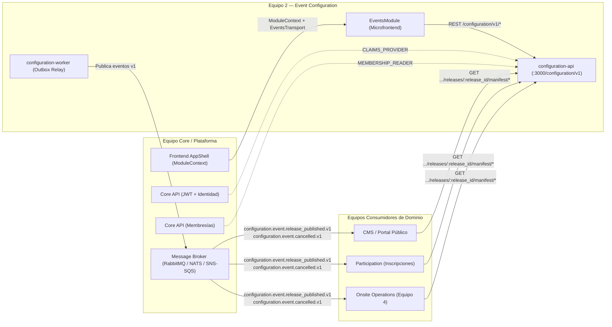

# Guía de Integración Externa — Event Configuration (Equipo 2)

Este documento describe **dónde y cómo deben conectarse los demás equipos y módulos de Nexo** con el microservicio `event-configuration` (`apps/configuration-api`, `apps/configuration-worker`) y el microfrontend `frontend/src/microfrontends/events`.

---

## 1. Mapa General de Integración



| Equipo / Sistema | Dirección | Punto de Conexión en `event-configuration` | Propósito |
| :--- | :--- | :--- | :--- |
| **Core / Identidad** | Proveedor hacia Equipo 2 | Token `CLAIMS_PROVIDER` (`src/shared/auth/claims-selection.ts`) | Resolver `TenantClaims` (`sub`, `organization_id`, `roles`, `scopes`) desde el `Bearer <access_token>` de Nexo Core. |
| **Core / Membresías** | Proveedor hacia Equipo 2 | Token `MEMBERSHIP_READER` (`src/events/infrastructure/adapters/membership-selection.ts`) | Validar que un `user_id` pertenece activamente al `organization_id` antes de asignarle un rol en un evento. |
| **Shell Frontend** | Proveedor hacia Equipo 2 | `<EventsModule context={context} transport={transport} />` (`frontend/src/microfrontends/events/EventsModule.tsx`) | Inyectar `tenantId`, `capabilities` y el transporte HTTP autenticado del Shell. |
| **Infraestructura / Broker** | Proveedor hacia Equipo 2 | `OutboxRelay` publisher (`apps/configuration-worker/src/main.mjs`) | Entregar mensajes de la tabla `events.outbox` al broker productivo. |
| **CMS / Portal Público** | Consumidor desde Equipo 2 | Topic `configuration.event.release_published.v1` + `GET .../manifest/artifacts/event` y `schedule` | Publicar páginas de evento, agenda y perfiles públicos de ponentes con consentimiento verificado. |
| **Participation (Inscripciones)** | Consumidor desde Equipo 2 | Topic `configuration.event.release_published.v1` + `GET .../manifest/artifacts/forms` y topic `configuration.event.cancelled.v1` | Renderizar y validar formularios de registro (`EVENT`, `PROGRAM`, `SESSION`), aplicar `registration_policy` y cortar registros ante cierres/cancelaciones. |
| **Onsite Operations (Equipo 4)** | Consumidor desde Equipo 2 | Topic `configuration.event.release_published.v1` + `GET .../manifest/artifacts/schedule` y `event` | Sincronizar sedes, salas (`capacity`, `accessibility`), sesiones programadas y horarios para check-in y control de aforo. |

---

## 2. Conexión para el Equipo Core (Identidad y Membresías)

### 2.1 Conectar el Proveedor de Identidad (`CLAIMS_PROVIDER`)

Toda petición HTTP entrante a `configuration-api` pasa por `AuthGuard`, el cual delega la extracción y verificación de credenciales al puerto `ClaimsProvider`:

- **Archivo del contrato:** `apps/configuration-api/src/shared/auth/auth.guard.ts`
- **Archivo selector de fábrica:** `apps/configuration-api/src/shared/auth/claims-selection.ts`
- **Inyección DI en módulos:** `EventsModule`, `ScheduleModule`, `FormsModule`, `PublishingModule`

#### Interfaz a implementar:
```ts
// apps/configuration-api/src/shared/auth/auth.guard.ts
export interface ClaimsRequest {
  headers: Record<string, string | string[] | undefined>;
  ip?: string;
  tenantClaims?: TenantClaims;
}

export interface ClaimsProvider {
  resolve(request: ClaimsRequest): TenantClaims | Promise<TenantClaims>;
}

// apps/configuration-api/src/shared/auth/tenant-claims.interface.ts
export interface TenantClaims {
  sub: string;              // UUID del usuario autenticado en Nexo Core
  organization_id: string;  // UUID del tenant/organización activa (usado por PostgreSQL RLS)
  roles: string[];          // Ej.: ['owner'], ['admin'], ['event_manager']
  scopes: string[];         // Permisos: 'events:read' | 'events:write' | 'events:publish'
  request_id?: string;
  client_ip?: string;
  user_agent?: string;
}
```

#### Cómo enganchar la implementación real:
1. Crear un adaptador (por ejemplo `JwtClaimsProvider implements ClaimsProvider` en `apps/configuration-api/src/shared/auth/`) que verifique el header `Authorization: Bearer <access_token>` emitido por Nexo Core y devuelva el `TenantClaims`.
2. Registrarlo en `selectClaimsProvider` dentro de `apps/configuration-api/src/shared/auth/claims-selection.ts` cuando `AUTH_MODE=jwt` (o `AUTH_MODE=nexo`).

> [!IMPORTANT]
> `AuthGuard` valida estrictamente que `sub` y `organization_id` sean UUIDs válidos, que `scopes` no contenga duplicados ni strings vacíos, y aplica ese `organization_id` en cada transacción PostgreSQL mediante `SET LOCAL app.current_organization_id` (Row-Level Security).

---

### 2.2 Conectar el Lector de Membresías (`MEMBERSHIP_READER`)

Cuando un organizador asigna permisos sobre un evento a otro usuario (`POST /configuration/v1/events/:id/assignments`), `EventsService` consulta el puerto `MembershipReader` para garantizar que el usuario destino pertenece activamente a la misma organización:

- **Archivo del puerto:** `apps/configuration-api/src/events/domain/ports/membership-reader.port.ts`
- **Archivo selector de fábrica:** `apps/configuration-api/src/events/infrastructure/adapters/membership-selection.ts`

#### Interfaz a implementar:
```ts
// apps/configuration-api/src/events/domain/ports/membership-reader.port.ts
export const MEMBERSHIP_READER = Symbol('MEMBERSHIP_READER');

export interface MembershipReader {
  validateActiveMembership(
    organizationId: string,
    userId: string,
  ): Promise<{ isValid: boolean; reason?: string }>;
}
```

#### Cómo enganchar la implementación real:
1. Implementar `MembershipReader` consultando el endpoint de membresías de Nexo Core (`http://localhost:8081`) y devolver `{ isValid: true }` si el usuario tiene membresía activa en `organizationId`, o `{ isValid: false, reason: '...' }` en caso contrario.
2. Retornar esa instancia desde `selectMembershipReader` en `apps/configuration-api/src/events/infrastructure/adapters/membership-selection.ts`.

---

## 3. Conexión para Consumidores de Eventos y Releases (CMS, Participation, Onsite)

`event-configuration` separa el **estado de edición en borrador** del **estado publicado inmutable**. Los demás microservicios **no deben acoplarse a las tablas ni borradores internos de edición**; deben consumir las **Releases publicadas** siguiendo este flujo de 3 pasos:

### Paso 1 — Escuchar los Eventos de Dominio (Outbox / Broker)

El worker publica dos eventos con validación JSON Schema Draft 2020-12:

#### A) Evento de Publicación de Release: `configuration.event.release_published.v1`
- **Schema JSON:** `contracts/configuration/schemas/configuration.event.release_published.v1.json`
- **Ejemplo:** `contracts/configuration/examples/configuration.event.release_published.v1.json`

```json
{
  "message_id": "1194eb00-0000-7000-8000-000000000101",
  "domain_event_id": "2194eb00-0000-7000-8000-000000000101",
  "topic": "configuration.event.release_published.v1",
  "schema_version": 1,
  "producer": "configuration",
  "organization_id": "0194eb00-0000-7000-8000-000000000001",
  "business_event_id": "0194eb00-0000-7000-8000-000000000002",
  "occurred_at": "2026-11-01T10:00:00Z",
  "published_at": "2026-11-01T10:00:01Z",
  "actor": { "type": "user", "id": "0194eb00-0000-7000-9000-000000000001" },
  "correlation_id": "0194eb00-0000-7000-8000-000000000103",
  "aggregate": {
    "type": "release",
    "id": "0194eb00-0000-7000-8000-000000000003",
    "version": 1
  },
  "partition_key": "0194eb00-0000-7000-8000-000000000001:0194eb00-0000-7000-8000-000000000002",
  "data": {
    "publication_id": "0194eb00-0000-7000-8000-000000000003",
    "release_version": 1,
    "manifest_ref": "/configuration/v1/events/0194eb00-0000-7000-8000-000000000002/releases/0194eb00-0000-7000-8000-000000000003/manifest",
    "manifest_hash": "2db3ef9e5a74e4a6de78308243bfeb6a0019dfa244546b8e71077e1080e624bc",
    "effective_at": "2026-11-01T10:00:00Z"
  }
}
```

#### B) Evento de Cancelación de Evento: `configuration.event.cancelled.v1`
- **Schema JSON:** `contracts/configuration/schemas/configuration.event.cancelled.v1.json`
- **Ejemplo:** `contracts/configuration/examples/configuration.event.cancelled.v1.json`

```json
{
  "topic": "configuration.event.cancelled.v1",
  "schema_version": 1,
  "producer": "configuration",
  "organization_id": "0194eb00-0000-7000-8000-000000000001",
  "business_event_id": "0194eb00-0000-7000-8000-000000000002",
  "data": {
    "event_id": "0194eb00-0000-7000-8000-000000000002",
    "release_id": null,
    "reason_code": "ORGANIZER_CANCELLED",
    "effective_at": "2026-11-20T10:00:00Z"
  }
}
```

---

### Paso 2 — Descargar el Manifiesto y los Artefactos Inmutables vía HTTP

Al recibir `configuration.event.release_published.v1` (o mediante consulta directa HTTP con scope `events:read`), el servicio consumidor descarga el manifiesto usando `data.manifest_ref`:

| Método y Ruta | Scope Requerido | Descripción |
| :--- | :--- | :--- |
| `GET /configuration/v1/events/:id/releases` | `events:read` o `events:write` | Lista todas las releases publicadas del evento (ordenadas por `version`). |
| `GET /configuration/v1/events/:id/releases/:release_id/manifest` | `events:read` o `events:write` | Devuelve el `ReleaseManifest` con el `manifest_hash` y las referencias (`ref` + `sha256`) a los 3 artefactos. |
| `GET /configuration/v1/events/:id/releases/:release_id/manifest/artifacts/event` | `events:read` o `events:write` | Devuelve el snapshot inmutable de metadatos, fechas, sede, estado y `registration_policy` del evento. |
| `GET /configuration/v1/events/:id/releases/:release_id/manifest/artifacts/schedule` | `events:read` o `events:write` | Devuelve programas, sesiones programadas (`scheduled`), sedes/salas y ponentes con `public_consent = true`. |
| `GET /configuration/v1/events/:id/releases/:release_id/manifest/artifacts/forms` | `events:read` o `events:write` | Devuelve los formularios publicados (`schema`, `ui_schema`) y sus `bindings` (`EVENT`, `PROGRAM`, `SESSION`). |

> [!TIP]
> **Implementación de Referencia Lista para Copiar:**
> En `tests/contract-consumer/release-consumer-simulator.ts` existe un consumidor completo de referencia (`ReleaseConsumerSimulator`) que implementa:
> - Deduplicación idempotente por `message_id`.
> - Protección contra entregas fuera de orden (`release_version` menor o igual a la versión ya activa).
> - Verificación criptográfica SHA-256 (RFC 8785 Canonical JSON) tanto del manifiesto (`manifest_hash`) como de cada artefacto (`artifact.sha256`).

---

### Paso 3 —Qué debe consumir cada Equipo

#### A) Equipo Participation (Inscripciones y Formularios)
1. **Consumir el artefacto `forms`:**
   - Llamar a `GET /configuration/v1/events/:id/releases/:release_id/manifest/artifacts/forms`.
   - Contiene los formularios publicados (`schema` JSON Schema, `ui_schema`, `consent_Version`) y los `bindings` activos por alcance:
     - `scope_type: 'EVENT'` → Formulario general de inscripción al evento.
     - `scope_type: 'PROGRAM'` → Formulario específico de un programa/track (`scope_ref_id = program_id`).
     - `scope_type: 'SESSION'` → Formulario específico de una actividad/sesión (`scope_ref_id = session_id`).
2. **Consumir el artefacto `event`:**
   - Verificar `policy` / `status` del evento para saber si las inscripciones están abiertas o cerradas (`POST /configuration/v1/events/:id/closures` actualiza la política a `registration_open: false`).
3. **Reaccionar a `configuration.event.cancelled.v1`:**
   - Bloquear inmediatamente nuevas inscripciones para `data.event_id` e iniciar el flujo de notificación a inscritos.

#### B) Equipo Onsite Operations (Equipo 4 — Check-in y Operación Presencial)
1. **Consumir los artefactos `event` y `schedule`:**
   - Llamar a `GET /configuration/v1/events/:id/releases/:release_id/manifest/artifacts/schedule`.
   - Extraer:
     - **Sedes y Salas (`venues`):** `id`, `kind` (`venue` | `room`), `parent_venue_id`, `name`, `capacity`, `accessibility`.
     - **Programas (`programs`):** `id`, `name`, `slug`.
     - **Sesiones (`sessions`):** `id`, `program_id`, `venue_id`, `title`, `starts_at`, `ends_at`, `speaker_ids` (solo incluye sesiones en estado `scheduled` libres de conflictos horarios).
2. **Reaccionar a `configuration.event.cancelled.v1`:**
   - Deshabilitar el check-in para las sesiones del `event_id` cancelado.

#### C) Equipo CMS / Portal Público
1. **Consumir los artefactos `event` y `schedule`:**
   - El ensamblador de publicación (`ReleaseAssemblerService`) garantiza que ningún evento se publique si algún ponente asignado a una sesión carece de consentimiento público (`public_consent: true`), por lo que los datos dentro del artefacto `schedule` de un release publicado ya cumplen con la validación de privacidad para exhibición pública.

---

## 4. Conexión del Broker en el Worker (`configuration-worker`)

Actualmente `apps/configuration-worker/src/main.mjs` lee la tabla `events.outbox` con bloqueo de arrendamiento (`leased_by`, `lease_until`) y entrega cada mensaje a `SimulatedBroker`.

Para conectar el broker real de la plataforma:
1. Revisar el contrato del publicador en `apps/configuration-worker/src/infrastructure/messaging/simulated-broker.mjs`:
   ```js
   export class RealBrokerPublisher {
     async publish(record) {
       // record contiene: id, organization_id, topic, partition_key, payload (JSON envelope), headers
       // Publicar en RabbitMQ / NATS / Kafka / SNS-SQS
     }
   }
   ```
2. En `apps/configuration-worker/src/main.mjs`, inyectar la instancia del broker real en `new OutboxRelay(outboxRepository, brokerPublisher, config, workerId, console, updateHeartbeat)` según la variable de entorno `BROKER_MODE`.

---

## 5. Conexión del Shell Frontend (`frontend/src/microfrontends/events`)

El microfrontend `EventsModule` (`frontend/src/microfrontends/events/EventsModule.tsx`) expone la firma estándar de Nexo:

```tsx
import type { ModuleContext } from '../../platform/microfrontends/contracts';
import type { EventsTransport } from './api';

export function EventsModule({
  context,
  transport,
}: {
  context: ModuleContext;
  transport?: EventsTransport;
})
```

### Cómo inyectar un cliente HTTP personalizado desde el Shell:
Si el equipo de Plataforma centraliza un cliente HTTP compartido con renovación automática de tokens (`refresh_token`), puede inyectarlo a través de la prop `transport` implementando la interfaz `EventsTransport` definida en `frontend/src/microfrontends/events/api.ts`:

```ts
export interface EventsRequestOptions {
  method?: string;
  body?: unknown;
  revision?: number;
}

export interface EventsTransport {
  request<T = RecordData>(
    path: string,
    options?: EventsRequestOptions,
  ): Promise<T>;
}
```

---

## 6. Convenciones HTTP de `configuration-api`

Todos los clientes que consuman `/configuration/v1/*` deben respetar tres reglas de protocolo:

1. **Idempotencia obligatoria en escrituras (`POST` y `DELETE`):**
   - Enviar el header `Idempotency-Key: <uuid-v4-o-v7>`.
   - Reenviar la misma llave con el mismo payload devuelve la respuesta cacheada original; reenviar la misma llave con un payload distinto devuelve `409 Conflict` (`idempotency_conflict`).
2. **Control de concurrencia optimista en actualizaciones (`PATCH` y acciones sobre recursos versionados):**
   - Leer el header `ETag` (ej. `"1"`) o el campo `revision_number` / `revision` del recurso.
   - Enviar `If-Match: "1"` en la petición de modificación. Si otro usuario modificó el recurso antes, la API responde `412 Precondition Failed` (`stale_revision`).
3. **Formato de errores estándar RFC 9457 (`application/problem+json`):**
   - Todo error devuelve `Content-Type: application/problem+json` con la estructura:
     ```json
     {
       "type": "urn:problem:conflict",
       "title": "Conflict",
       "status": 409,
       "detail": "An event with this slug already exists in the site.",
       "instance": "/configuration/v1/events",
       "code": "slug_already_exists",
       "errors": [],
       "request_id": "0194eb00-0000-7000-8000-000000000099"
     }
     ```
   - La especificación completa de endpoints y esquemas está disponible en `docs/openapi.yaml`.
